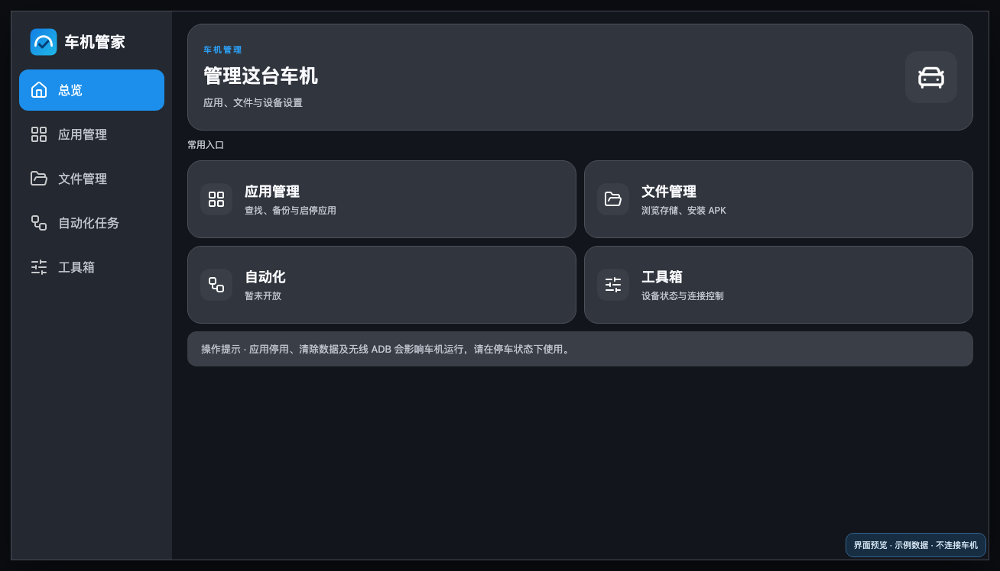
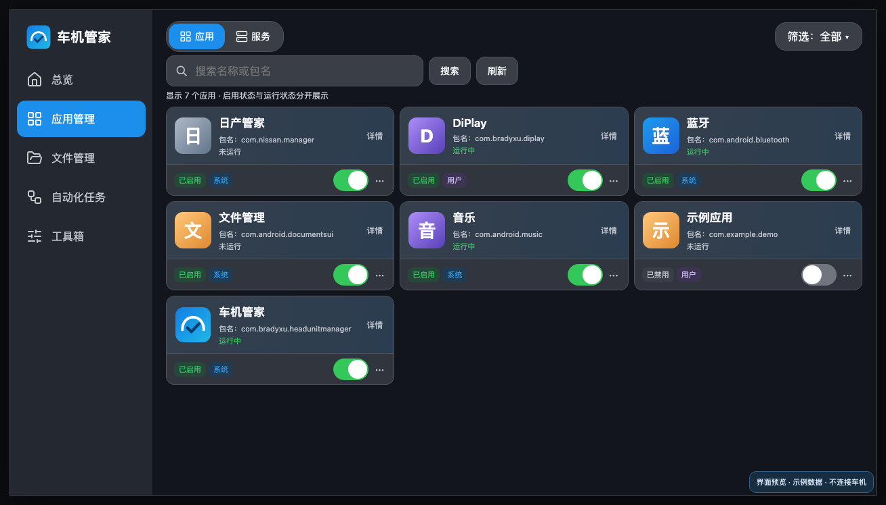
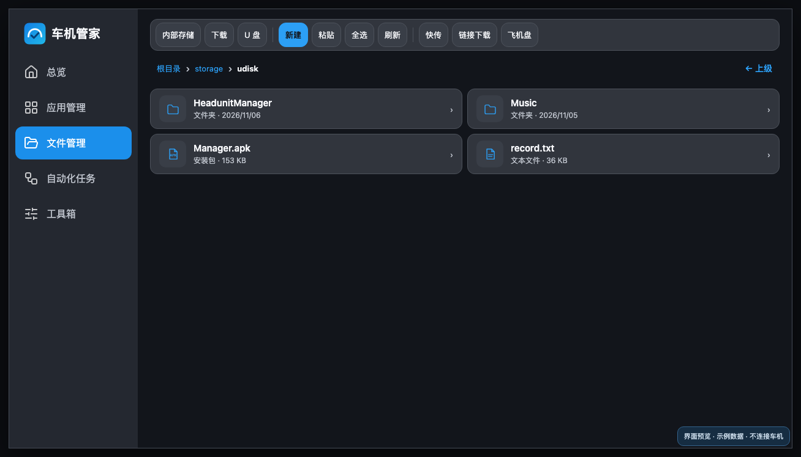
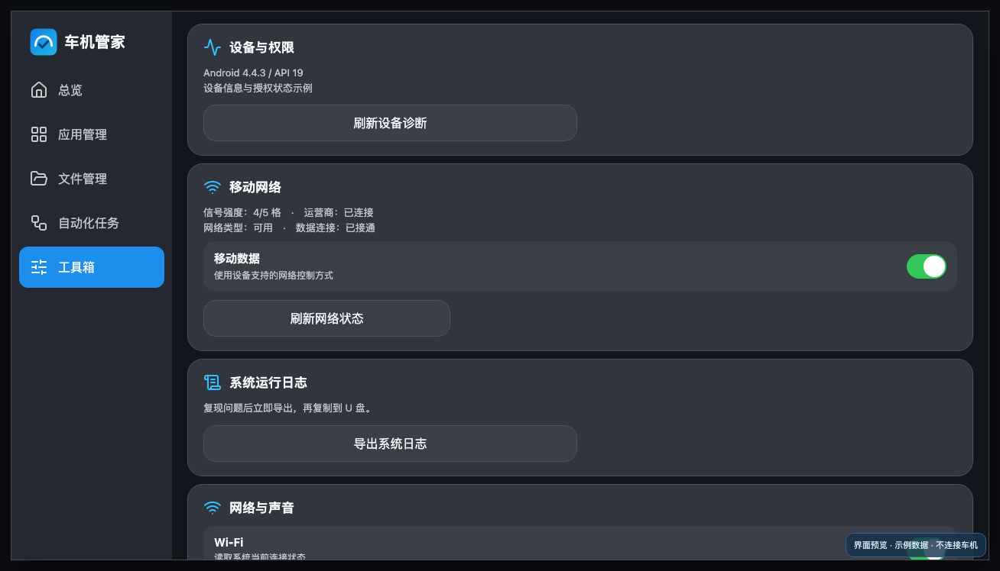

# 车机管家

面向横屏车机的 Android 管理工具，使用 Java 实现，兼容 Android 4.4.3（API 19）。

## 功能

- **应用与服务管理**：查看应用状态、搜索应用、管理服务组件、安装和备份 APK。
- **文件管理**：浏览本地存储和 U 盘，执行批量文件操作，并支持文件传输。
- **自动化任务**：功能尚未完善，当前版本不可用。
- **工具箱**：提供设备信息、连接状态、移动数据、蓝牙、音量、辅助功能和无线调试等工具。

部分功能取决于设备系统版本、厂商服务和已授予的权限。请先在目标设备上确认兼容性，再使用会改变系统或应用状态的操作。

## 界面预览

界面采用与 DiPlay 一致的深色扁平卡片风格。下图来自交互式原型，使用示例数据，不连接车机。自动化任务暂未开放，预览中仅显示不可用提示。

| 总览 | 应用管理 |
|:---:|:---:|
|  |  |

| 文件管理 | 工具箱 |
|:---:|:---:|
|  |  |

[打开交互式界面预览](docs/preview/index.html)

## 构建

需要 Android SDK Platform 19 和 Android Build Tools 35.0.1。设置 `ANDROID_SDK_ROOT` 后构建普通版：

```sh
ANDROID_SDK_ROOT=/path/to/android-sdk ./build.sh
```

输出位于 `build/HeadunitManager-Android4.4.apk`。

## 许可证与图标

本项目以 GNU GPL-3.0 许可证发布，详见 [LICENSE](LICENSE)。

部分界面图标来自 Lucide，许可文本见 [Lucide ISC License](docs/licenses/Lucide-ISC.txt)。
